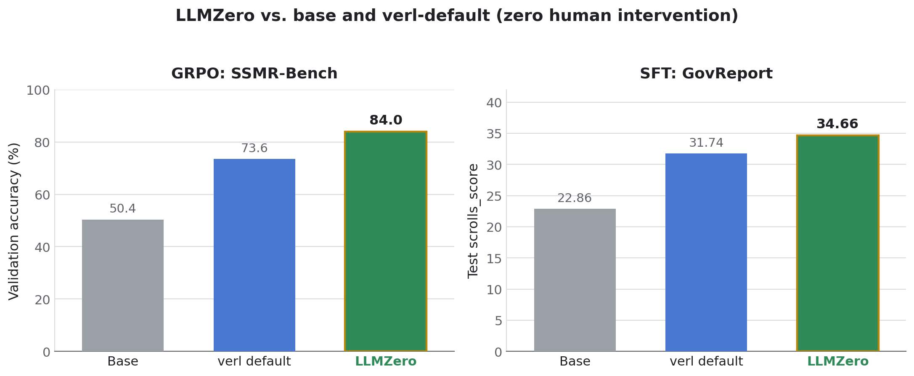
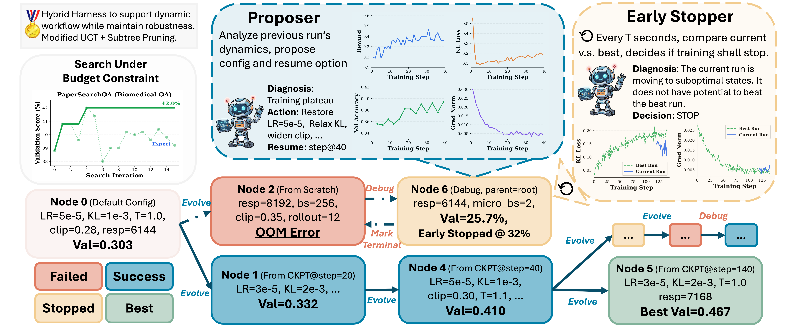

# LLMZero

**Agentic test-time scaling for LLM post-training: let LLM agents discover the training
strategy for you.**

<p align="left">
  
  
  <a href="https://arxiv.org/abs/2606.18388"></a>
</p>

Point LLMZero at a dataset and a model. A team of LLM agents writes the training code,
launches the jobs, reads the live training curves, and keeps searching for a better
**training strategy** until the budget runs out. Instead of a human hand-tuning a recipe,
LLMZero spends test-time compute to find one. No human in the loop.

Official implementation of the EMNLP 2026 (Findings) paper
[*LLMZero: Discovering Adaptive Training Strategies for RL Post-Training via LLM Agents*](https://arxiv.org/abs/2606.18388).
The tree search is upgraded to **[ExTS](https://github.com/amazon-science/ExTS)** (*Exploit
More, Explore Smarter*, EMNLP 2026 Findings,
[arXiv:2608.23848](https://arxiv.org/abs/2608.23848)), the official implementation of that
paper, which replaces the modified-UCT search used in the LLMZero paper.

A *strategy* is more than a hyperparameter set: it is the whole recipe the agents
co-optimize, including the config, when to warm-start from a prior checkpoint, when to stop a
run early, and which checkpoint to promote.

LLMZero is **ready to run out of the box**, shipping end-to-end GRPO and SFT examples on the
public verl 0.9.0 stack, and **fully pluggable**: the training framework and the compute
backend are both extensible registries.

## Results

LLMZero takes an untouched `Qwen/Qwen3-4B` and, with **zero human intervention**, lifts it
well past both the untrained base and a one-shot verl-default run on two public tasks: GRPO on
SSMR-Bench (music-theory MCQ) and SFT on GovReport (long-document summarization).

<p align="center">
  
</p>
<p align="center"><sub><i>Results on this repo's two example tasks (Qwen3-4B, verl 0.9.0
LoRA). GRPO SSMR-Bench: validation accuracy 0.504 → 0.736 → 0.840. SFT GovReport: test
scrolls_score 22.86 → 31.74 → 34.66.</i></sub></p>

These are out-of-the-box, plug-in numbers, not a hand-tuned result; careful prompt and
description tuning informed by human priors can push them further. The paper reports results
across more benchmarks, but those experiments ran on an internal edition of verl that cannot
be open-sourced; for this release we integrated the public **verl 0.9.0** stack and ran the
two fresh runs above. The SFT path itself was built end to end by Claude Code (Opus 4.8)
driving the existing Agent Skills with no human edits; we then ran GovReport on it, supplying
only the dataset and the base model. Full numbers, the two runnable example folders under
[examples/](examples/), and reproduction steps: [docs/benchmarks.md](docs/benchmarks.md).

**From the paper:** across the broader benchmark suite, the strategy LLMZero discovers leads
every baseline, static (practitioner recipe, random/grid search) and adaptive (a skill-based
LLM agent), on all four GRPO tasks:

| Method | Type | ChemCoT<br><sub>chem</sub> | PaperSQA<br><sub>biomed</sub> | SSMR<br><sub>music</sub> | WildSci<br><sub>science</sub> |
|--------|:----:|:----:|:----:|:----:|:----:|
| Qwen3-4B (no training) | – | 16.9 | 31.6 | 51.4 | 53.6 |
| Practitioner recipe | static | 33.0 | 39.0 | 65.8 | 53.2 |
| Random search | static | 39.4 | 37.6 | 74.4 | 55.8 |
| Grid search | static | 35.2 | 39.0 | 77.6 | 53.0 |
| Skill-based LLM agent | adaptive | 37.0 | 40.2 | 80.0 | 56.6 |
| **LLMZero** | adaptive | **40.5** | **42.6** | **82.2** | **58.5** |

<sub>Test score (%) at the best-validation node within 16 iterations, Qwen3-4B. Results from
the paper, on the internal verl edition; see the citation below.</sub>

## How it works

LLMZero turns post-training into a search over training strategies, and scales test-time
compute to explore it. Each node in the search tree is **one training run** (either trained
from scratch, or a continuous run that warm-starts from a parent node's checkpoint). An
LLM-powered proposer (the LLM is configurable, see **Configuration** below) reads the
parent run's live training curves, diagnoses what happened (plateau, KL spike, truncated
responses, instability), and proposes the next node: a new strategy plus a resume point. An
early stopper kills runs that cannot beat the best, so the budget flows to candidates that
can.

<p align="center">
  
</p>
<p align="center"><sub><i>An illustrative LLMZero search: the proposer diagnoses each run and
proposes the next node's strategy and resume point; the early stopper kills runs that cannot
beat the best. (Example from the paper.)</i></sub></p>

The tree is grown by **[ExTS](https://github.com/amazon-science/ExTS)** (Exploit More,
Explore Smarter), a budget-aware selection policy purpose-built for agentic test-time
scaling, where every evaluation is an expensive, noisy training run. Where vanilla MCTS/UCT
only balances exploration against exploitation, ExTS adds soft reward normalization, a
failure-aware node value, quantile-gated expansion with progressive widening, and an adaptive
rule that decides whether to open a new branch or deepen an existing one. Under a tight
budget, that means exploiting strong candidates harder while exploring smarter.

**Around that loop, a team of specialized LLM agents does the hands-on work:** perceive the
task and data, pick a training framework, retrieve tutorials, write the training and launch
scripts, submit jobs, diagnose failures, rerank results, and decide when to stop.

The default training stack is [verl](https://github.com/volcengine/verl) 0.9.0 (GRPO/PPO and
SFT), but the **training framework** and the **compute backend** are both pluggable (see
**Backends and frameworks** below).

## Getting started

### 📦 Install

```bash
git clone https://github.com/amazon-science/LLMZero && cd LLMZero
pip install -e .
```

### 🚀 Drive it two ways

**Natural language.** Open Claude Code inside the repo and describe your run in plain English.
The Agent Skills are auto-detected and invoked for you, as long as the training framework and
compute backend you need are already implemented:

```
Train Qwen3-4B on <hf-org>/<dataset> with GRPO on 8 A100s on our Slurm cluster.
Run a synchronized search for 8 iterations and enable continuous training.
You can refer to the reward function here: examples/grpo_ssmr_qwen3_4b/reward_fn.py.
```

**Direct CLI.** Call `llmzero` yourself:

```bash
llmzero -i ./my_task -t "Train Qwen3-4B with 8 GPUs" -n 16 \
    --compute-backend conda --conda-env my_rl_env --num-gpus 8
```

Full walkthrough of both paths, every backend, and all flags:
**[docs/quick-start.md](docs/quick-start.md)**.

### 🔌 Backends and frameworks

Both are pluggable registries, and both are easy to extend: subclass one ABC, or let the
`/general-add-training-framework` skill scaffold the plugin from a sample log. The `verl_sft`
framework shipped here was added by that automated route end to end.

**Compute backends (5):** `raycluster` (Ray on Kubernetes), `conda` (local), `docker`
(local), `slurm` (remote Slurm + conda), and `slurmdocker` (remote Slurm + pyxis/enroot). The
search agent and the training jobs can run in different places (for example, agent on a login
node, training on remote GPU nodes).

**Training frameworks (2):** `verl_grpo` (verl 0.9.0 GRPO/PPO, the default) and `verl_sft`
(supervised fine-tuning). The search agents run on Amazon Bedrock, OpenAI, Anthropic, or
SageMaker.

Details, examples, and the full tables are in [docs/quick-start.md](docs/quick-start.md) and
[docs/onboarding-a-training-framework.md](docs/onboarding-a-training-framework.md).

### ⚙️ Configuration

With the Agent Skills, set the compute backend, hardware, and model defaults in
`constants/cluster.json` (per-backend templates ship as
`constants/cluster.<backend>.example.json`). The search loop, per-agent LLM settings (model,
provider, temperature), early stopper, and proposer live in Hydra YAML under
`src/autogluon/llmzero/configs/`; CLI flags override config at runtime. See
[docs/quick-start.md](docs/quick-start.md#configuration).

## ⚠️ Agentic safety

The Agent Skills are built for approval-free, end-to-end automation: they download datasets,
write code, and submit training jobs without pausing for manual approval at each step. Run
them only on dedicated training machines you control and trust.

## Citation

If you use LLMZero, please cite both the LLMZero paper and the ExTS search it builds on:

```bibtex
@article{fang2026llmzero,
  title={LLMZero: Discovering Adaptive Training Strategies for RL Post-Training via LLM Agents},
  author={Fang, Haoyang and Zhu, Wei and Han, Boran and Zhang, Alex and Pan, Zhenyu and Yang, Shuo and Zhang, Shuai and Gai, Jiading and Tang, Peng and Hu, Cuixiong and others},
  journal={arXiv preprint arXiv:2606.18388},
  year={2026}
}

@article{fang2026exploit,
  title={Exploit more, explore smarter for budget-constrained agentic search},
  author={Fang, Haoyang and Wang, Bernie},
  journal={arXiv preprint arXiv:2608.23848},
  year={2026}
}
```
